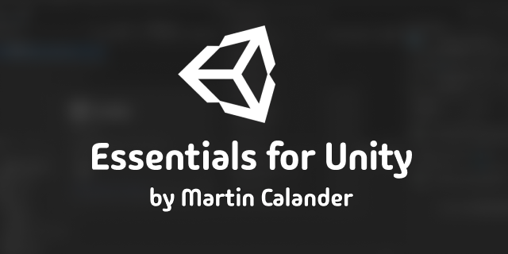

# Alpha Compatibility

A maintained collection of small, version-scoped workarounds for Unity alpha
releases. Each fix lives with its regression tests and a record of why it
exists, which versions need it, and when it can be removed.

Package: `com.martincalander.alphacompatibility`

Minimum Editor: Unity 7 (`7000.0`)

License: [Proprietary License](LICENSE.md), owned by Martin Calander.

The imported assemblies are Editor-only. Each workaround has its own assembly
and package constraints. Optional source fixes also repair lifecycle behavior
in installed Unity packages, including their runtime assemblies. These fixes
are applied explicitly before validation; installing this package alone does
not modify another package or the Library cache.

## Installation

The repository is public. Use **Package Manager > Install package from git URL**:

```text
https://github.com/EssentialsForUnity/com.martincalander.alphacompatibility.git
```

The Git URL follows the repository's default `main` branch. To install through
the project manifest, add this entry to `Packages/manifest.json`:

```json
"com.martincalander.alphacompatibility": "https://github.com/EssentialsForUnity/com.martincalander.alphacompatibility.git"
```

Use one installation source per project. Remove an older embedded copy or
submodule and any equivalent host RenderGraph shim when switching to the Git
dependency. Keep `enableLockFile` set to `false` and the generated
`Packages/packages-lock.json` untracked in hosts that follow the latest upstream
Git dependencies. Repository visibility does not change the proprietary license.

The RenderGraph fix requires these packages already installed in the host:

| Package | Required version | Purpose |
| --- | --- | --- |
| `com.unity.pipeline` | Exactly `0.9.0-exp.1` | Command registry being adapted |
| `com.unity.render-pipelines.core` | Exactly `17.7.0` | Original RenderGraph handlers, usually supplied by URP or HDRP |
| `com.martincalander.gitsubmodulemanager` | `0.8.1` or newer with the same Harmony plugin | Shared Editor patching library |

Install Git Submodule Manager from its upstream default branch if needed:

```text
https://github.com/martincalander/GitSubmoduleForUnity.git
```

These are optional integration prerequisites, so the package manifest does not
force their installation or downgrade a host's packages. The RenderGraph
assembly and tests are excluded unless all three constraints are satisfied.
When Pipeline or SRP Core changes version, this fix becomes inactive pending
review. The runtime version check also requires the exact affected pair.

The first release reuses Git Submodule Manager's Harmony provider. It does not
ship a second copy of Harmony. See [Third Party Notices](Third%20Party%20Notices.md).

## Source fixes

Some Unity lifecycle metadata is generated while compiling the affected package.
An Editor patch cannot add that metadata afterward. The source-fix tool keeps
these changes separate from the automatic Editor workarounds.

With Python 3.9 or newer, run the tool from this package checkout or its resolved
package directory. Close the target Editor before applying source fixes:

```sh
python3 Tools~/apply-source-fixes.py --project "$PROJECT" --check \
  --fix pipeline-lifecycle-0.9.0-exp.1 --fix urp-rendering-lifecycle-17.7.0
python3 Tools~/apply-source-fixes.py --project "$PROJECT" --apply \
  --fix pipeline-lifecycle-0.9.0-exp.1 --fix urp-rendering-lifecycle-17.7.0
```

Select only fixes for packages installed in that project. Start with a check,
apply reviewed fixes, then resolve packages, recompile, and run the relevant
tests in Unity.
The tool requires the affected package to be present in the project or its
resolved package cache. It checks the Editor version, package version, and exact
source hashes before changing anything. It embeds a complete copy when needed,
preserves upstream metadata and licenses, and never edits `Library/PackageCache`.
Upstream `AGENTS.md` instruction files and their matching metadata are excluded
when embedding packages, keeping workspace guidance at the host root.
Unknown local edits to a target file require review rather than being overwritten.

Commit the resulting embedded package with the host project so a fresh checkout
has the fixes before its first compilation. Updating this Git dependency does
not update an embedded vendor package. Review and retire its source fixes when
upgrading that vendor package.

The source-fix records cover Pipeline `0.9.0-exp.1` and URP `17.7.0` on Unity 7.
They preserve the equivalent fixes already present in CaveExpedition and apply
the same generic behavior to the other affected hosts. They do not copy Cave's
lighting, rendering, or game-specific customizations.

## Workaround record

### RG-001: RenderGraph command discovery

**Status:** Active for Pipeline `0.9.0-exp.1` and SRP Core `17.7.0`.

**Symptom:** SRP Core declares 15 commands with names such as
`render_graph.graphs`. Pipeline 0.9 requires a separate command group and name,
so these declarations fail validation and disappear from discovery.

**Fix:** A scoped prefix on `CommandRegistry.ReadDeclaration` translates only
declarations from `UnityEditor.Rendering.CLI.RenderGraphDebugCLI` in
`Unity.RenderPipelines.Core.Editor.CLI`. For example, `render_graph.graphs`
becomes group `render_graph`, command `graphs`. Nested groups such as
`render_graph.passes` are preserved. The original handlers, parameters, tags,
thread requirements, and descriptions remain intact. Pipeline still validates
the translated declarations.

Initialization clears the discovery cache and is idempotent. Code unload
removes only this fix's Harmony prefix and clears the cache again. Asset import
worker processes do not apply the patch.

**Verified host:** Unity `7000.0.0a11`, CLI `1.0.0-beta.14`, Pipeline
`0.9.0-exp.1`, SRP Core `17.7.0`, and Git Submodule Manager `0.8.1`.

**Coverage:** All 15 handlers and their metadata, normal validation failures,
unrelated providers, already grouped declarations, version matching, repeated
initialization, cache rebuilding, and cleanup preserving other Harmony owners.

**Extraction verification (2026-10-21):** Unity imported and compiled both
Editor assemblies. All 36 NUnit cases passed with 384 assertions, zero failures,
and zero skips in the running Editor. The normal Unity TestRunner was cancelled
at its save prompt for an unsaved scene; the same synchronous NUnit cases ran
through Pipeline `script run` with an inline main-thread dispatcher instead.
The scene's handle, path, load state, and dirty state were unchanged. This run
does not exercise Unity TestRunner's scene orchestration or log hooks.

Fresh command discovery contained all 15 handlers, and `render_graph graphs`
reached the original handler's expected no-capture response. CompilationPipeline
reported both package assemblies as Editor-only and neither in the player
assembly list. Only the package's new Harmony owner remained registered. The
initial compile request timed out during reload; a fresh request after reconnect
reported up-to-date scripts with no compilation errors. Installation without
the prerequisites and with upgraded package versions was not exercised. Player
builds and PlayMode tests were omitted because the package has no runtime code.

**Remove when:** An upstream SRP Core release uses accepted grouped declarations,
or Pipeline accepts these legacy declarations itself. First verify all 15
handlers are discovered without the patch, then remove its assembly and tests
and record the fixed upstream versions here and in the changelog. No upstream
issue reference is recorded yet.

### ASE-001: Aseprite tile sprite identity

**Status:** Active on Unity 7 with Aseprite `7.0.0` or `7.0.1`.

**Symptom:** The importer uses a process-dependent string hash to match tile
sets. After restarting the CoreCLR Editor, reimport can replace existing sprite
identities and break serialized references.

**Fix:** An asset preprocessor updates the saved matching key to the current
process's value before the importer matches tile sets. Existing sprite IDs stay
with their source tiles. The assembly is excluded when Aseprite is absent or its
version is outside the affected pair. It requires no Harmony provider.

**Coverage:** A synthetic two-tile file, stale matching keys, repeated imports,
and a two-process reimport check. The synthetic fixture is independent of game
assets. Keep authored Aseprite layer UUIDs and source save settings.

**Remove when:** The importer uses stable tile-set matching across Editor
processes. Verify sprite GUIDs and local file IDs survive a fresh-process import
without this preprocessor before removing it.

### PIPE-001: Pipeline code and Play Mode lifecycle

**Status:** Explicit source fix for Pipeline `0.9.0-exp.1` on Unity 7.

**Symptom:** Server callbacks and native file watchers can survive code unload;
method reload state and immutable metadata caches can be reset inconsistently
when entering or leaving Play Mode without a domain reload.

**Fix:** Scoped teardown preserves watch preferences and journals. Session state
and the discovery latch reset together. Compile-time lifecycle annotations keep
immutable metadata and explicitly managed state from automatic static cleanup.
The source fix excludes Cave's separate change to the lightmapper command.

**Remove when:** An upstream Pipeline package implements equivalent unload and
retained-domain lifecycle behavior. Run the focused lifecycle suite and repeated
Play Mode checks before returning to its unmodified package source.

### URP-001: RenderingUtils resource lifecycle

**Status:** Explicit source fix for URP `17.7.0` on Unity 7.

**Symptom:** Cached fullscreen mesh and fallback material resources require
explicit disposal around code unload and retained-domain Play Mode transitions.

**Fix:** Preserve the static owner and dispose its native resources through
Unity lifecycle callbacks. The resources are recreated when next requested.
This record covers only the generic RenderingUtils resources, not project-owned
light registries, water, fog, or exposure effects.

**Remove when:** An upstream URP version owns these resources correctly through
the same lifecycle transitions. Verify cleanup, repeated cleanup, and recreation
without this source fix before removing the embedded replacement.

## Other compatibility fixes

The following fixes remain with the package that owns the affected source or
assets. They are not supplied automatically by Alpha Compatibility.

| Area | Affected installed hosts | Handling |
| --- | --- | --- |
| Addressables `4.1.1` Unity 7 development-build compilation flag | EssentialsWorkspace, CaveExpedition | Both retain the existing source guard. Compilation must succeed before Editor patches can load. |
| Cinemachine `6.7.0` input initialization order | CaveExpedition | Retain its source initialization fix. Other audited hosts do not install Cinemachine. |
| Obi native serialization and managed pinning | CaveExpedition | Retain its runtime source fixes. Other audited hosts do not install Obi. |
| Steam Audio macOS CoreCLR native binding | CaveExpedition | Retain its player binding fix and native libraries. Other audited hosts do not install Steam Audio. |
| Water, fog, exposure, and custom rendering ownership | CaveExpedition | Retain package-specific lifecycle support and authored rendering behavior. |
| Git Submodule Manager, Minimal Editor, Project Icon, and Essentials API support | Hosts using those packages | Retain the owning package's tested integrations and lifecycle support. Alpha Compatibility also uses Git Submodule Manager's Harmony provider for RG-001. |

Do not install an unrelated package solely to apply its workaround. This inventory
records the five audited hosts; it is not a claim about every Unity alpha release.

## Verification

For a Git installation, add `com.martincalander.alphacompatibility` to the host
manifest's `testables` array. Embedded packages expose their tests directly.
Use the host's Unity Test Framework to run the applicable Alpha Compatibility
EditMode assemblies. The original RenderGraph assembly is
`MartinCalander.AlphaCompatibility.Editor.Tests`. Optional integration assemblies
are included only when their version constraints match.

The source-fix suites report an explicit skip when their optional source fix is
absent. A host being validated with those fixes must run them with zero skips.
On a host with Pipeline and URP source fixes, run these assemblies:

- `MartinCalander.AlphaCompatibility.Editor.Tests` (36 RenderGraph cases)
- `MartinCalander.AlphaCompatibility.Editor.PipelineLifecycle.Tests` (8 cases)
- `MartinCalander.AlphaCompatibility.Editor.UrpSource.Tests` (6 cases)
- `MartinCalander.AlphaCompatibility.Editor.Aseprite.Tests` (2 cases, when Aseprite is installed)

The source tool's rollback, refusal, preservation, and repeat-application checks
run with `python3 -m unittest discover -s Tools~ -p 'test_*.py'`.

**0.2.0 prepublication checks (2026-10-22):** On Unity `7000.0.0a11`,
EssentialsWorkspace passed all 50 applicable EditMode cases and SuperBigBoyBoxing
passed all 52, with no failures or skips. The source tool passed all 10 Python
checks. A generated two-tile Aseprite file was also imported in two separate
Editor processes: the process-dependent matching key changed, while both sprite
GUIDs and their imported asset GUIDs/local IDs stayed identical. Aseprite `7.0.1`
was exercised; `7.0.0` is included by its version gate but was not installed for
this run. Other Editor versions were not exercised.

Discover the host's current Pipeline command schemas before invoking commands.
For the verified versions, the focused checks are:

```sh
unity --format json command script recompile --project-path "$PROJECT"
unity --format json command script recompile_status --project-path "$PROJECT"
unity --format json command test run --mode editor --filter MartinCalander.AlphaCompatibility.Editor.Tests --filter_type assembly --project-path "$PROJECT"
unity --format json command --group-by flat --detail full --project-path "$PROJECT"
unity --format json command render_graph graphs --project-path "$PROJECT"
```

Wait for compilation to finish and inspect nested command results. Discovery
must include all 15 handlers from `Unity.RenderPipelines.Core.Editor.CLI`.
A command listing also contains generated group entries; do not count those as
handlers. Integration tests are only available for the affected package pair.

## Adding and retiring fixes

Add automatic workarounds under their own `Editor/` area with focused tests and
the smallest applicable version constraints. Source changes belong in a separate
version- and content-checked record under `SourcePatches~/`. Preserve upstream
ownership and licenses, and keep project-specific behavior with its owner. Add a record here describing the
symptom, affected Editor and package versions, upstream issue when known,
implementation scope, verification evidence, and explicit removal condition.
Update `CHANGELOG.md` when a fix is added, widened, changed, or removed.

Review the records whenever the Editor or related packages are upgraded. Keep
retired records with the upstream version that fixed the issue, and delete
obsolete patch code after verifying the unpatched behavior. Version changes
must not silently broaden a workaround's scope.
